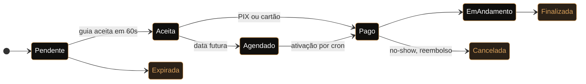

  

  

<table>
  <tr>
    <td align="center" width="170"><h2>6+</h2>anos em produção</td>
    <td align="center" width="170"><h2>570+</h2>testes automatizados</td>
    <td align="center" width="170"><h2>3</h2>sites de clientes no ar</td>
    <td align="center" width="170"><h2>8.2 → 8.4</h2>matriz de CI em PHP</td>
  </tr>
</table>

 

## Sobre mim

Desenvolvedor Full Stack na **iiBrasil Inteligência e Informação** desde 2020. Comecei no suporte técnico, passei para o desenvolvimento e hoje mantenho e modernizo **sistemas corporativos de gestão pública** que rodam em produção todos os dias.

Meu forte é **backend com PHP e Laravel**: regras de negócio complexas, APIs REST, modelagem relacional, otimização de SQL, controle de acesso, filas e integração entre sistemas. Trabalhar com legado me ensinou a **mudar o que é crítico sem quebrar o que funciona**, cuidando de integridade dos dados, segurança e desempenho.

Em paralelo, construo produtos para clientes reais e projetos próprios, cuidando do ciclo inteiro: arquitetura, banco, frontend, infraestrutura, testes e deploy.

> **Formação:** Análise e Desenvolvimento de Sistemas &nbsp;·&nbsp; MBA em Gerenciamento de Projetos

 

## Stack

 

 

<b>Ver detalhes por área</b>

 

| Área | Tecnologias e práticas |
|---|---|
| **Backend** | PHP, Laravel, Eloquent, APIs REST, filas, eventos, broadcasting e ACL |
| **Frontend** | JavaScript, TypeScript, React, Next.js, Tailwind CSS e Vite |
| **Banco de dados** | PostgreSQL, MySQL, Supabase, modelagem relacional e otimização de queries |
| **Infraestrutura** | Docker, Nginx, Linux, AWS S3, Azure Blob Storage e Vercel |
| **Integrações** | Mercado Pago (PIX e cartão), webhooks assinados, Pusher, Laravel Echo e Leaflet |
| **Qualidade** | PHPUnit, testes E2E, GitHub Actions, Sentry e code review |

 

## Projeto em destaque

<table>
<tr>
<td>

### Guivya &nbsp;

**Marketplace de passeios** que conecta turistas a guias locais de Ilhabela, no modelo dos apps de mobilidade: o turista pede, o guia tem **60 segundos** para aceitar, o pagamento é confirmado e os dois se encontram num ponto da ilha.

| | |
|---|---|
| **Fluxo** | Máquina de estados em enum, com transições controladas e expiração automática |
| **Pagamentos** | Mercado Pago com PIX e cartão, webhook assinado e reembolso automático de no-show |
| **Tempo real** | WebSockets para notificações e mapa ao vivo com guias e pontos turísticos |
| **Agendamento** | Ativação por cron, lembretes T-24h / T-2h e geofence de chegada |
| **Qualidade** | 570+ testes, CI em PHP 8.2, 8.3 e 8.4, CSP sem `unsafe-inline` e Sentry |

Repositório privado · posso mostrar código e decisões numa conversa

</td>
</tr>
</table>

 

## Outros projetos

<table>
<tr>
<td width="50%" valign="top">

### [Rotamar Ilhabela](https://www.rotamarilhabela.com.br/)

Passeios de lancha e observação de baleias jubarte, com **visualizador 3D da embarcação** no navegador.

`Three.js` `GLTF/Draco` `JSON-LD`

</td>
<td width="50%" valign="top">

### [Importados da Ilha](https://www.importadosdailha.com.br/)

Loja de eletrônicos com **painel administrativo**, preço no PIX e parcelamento calculados por produto.

`Next.js` `TypeScript` `Supabase`

</td>
</tr>
<tr>
<td width="50%" valign="top">

### [Pato Guia Ilhabela](https://www.patopasseioilhabela.com/)

Site de guia local, **mobile-first** e sem nenhuma dependência externa.

`HTML` `CSS` `JavaScript`

</td>
<td width="50%" valign="top">

### [Detector de Cores](https://github.com/vanngilha/color-detector)
 

Nome, RGB e HEX de qualquer cor **em tempo real pela webcam**, com visão computacional. [Ver demonstração ↗](https://www.youtube.com/watch?v=SoSC_lMgSrE)

`Python` `OpenCV` `Pandas`

</td>
</tr>
</table>

Sistemas corporativos e boa parte dos projetos de clientes ficam em repositórios privados.

 

## Como uso IA no desenvolvimento

Uso o **Claude Code** dentro de um fluxo com etapas fixas, cada uma apoiada por skills específicas. **A IA acelera a execução; arquitetura, validação e responsabilidade pelo código continuam comigo.**

<b>Ver skills de cada etapa</b>

 

| Etapa | Skills | O que garante |
|---|---|---|
| **01 · Discutir** | `discuss` `spec` | Ambiguidades resolvidas e decisões registradas antes do código |
| **02 · Planejar** | `plan` | Tarefas com dependências e critérios de aceite verificáveis |
| **03 · Executar** | `execute` | Entregas em commits pequenos e rastreáveis |
| **04 · Verificar** | `verify` `add-tests` | Comportamento validado de ponta a ponta e critérios virando testes |
| **05 · Revisar** | `code-review` `security-review` `ui-review` | Bugs, riscos de segurança e problemas de interface pegos no diff |
| **06 · Entregar** | `ship` | PR aberto só com testes e CI verdes |

Fora do fluxo principal, uso `debug` para investigar bugs com hipótese e evidência, e `map-codebase` para entender um código antes de mexer nele.

No **Guivya**, esse processo conduziu auditorias de código com correções em lotes de PR, a migração do gateway de pagamento e uma política de CSP sem `unsafe-inline`.

 

## Certificações

 

<picture>
  <source media="(prefers-color-scheme: dark)" srcset="https://raw.githubusercontent.com/vanngilha/vanngilha/output/snake-dark.svg"/>
  <source media="(prefers-color-scheme: light)" srcset="https://raw.githubusercontent.com/vanngilha/vanngilha/output/snake-light.svg"/>
  
</picture>

 

## Vamos conversar?

Tem uma vaga, um projeto ou um sistema legado precisando de cuidado? **Me chama.**

 

