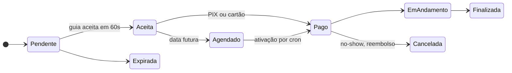

# Christopher Oliveira

### Desenvolvedor Full Stack · Backend

**PHP · Laravel · PostgreSQL · APIs REST**

Sistemas corporativos em produção desde 2020, integrações com terceiros e produtos completos do zero ao deploy.

Ilhabela, SP · Aberto a vagas Backend e Full Stack (CLT ou PJ) e freelas

 

<table>
<tr>
<td align="center" width="25%"><h3>6+ anos</h3>em produção</td>
<td align="center" width="25%"><h3>570+</h3>testes automatizados</td>
<td align="center" width="25%"><h3>5</h3>produtos no ar</td>
<td align="center" width="25%"><h3>PHP 8.2 a 8.4</h3>matriz de CI</td>
</tr>
</table>

## Sobre mim

Desenvolvedor Full Stack na **iiBrasil Inteligência e Informação** desde 2020. Comecei no suporte técnico, passei para o desenvolvimento e hoje mantenho e modernizo sistemas corporativos de gestão pública que rodam em produção todos os dias.

Meu forte é **backend com PHP e Laravel**: regras de negócio complexas, APIs REST, modelagem relacional, otimização de SQL, controle de acesso, filas e integração entre sistemas. Trabalhar com legado me ensinou a mudar o que é crítico sem quebrar o que funciona, cuidando de integridade dos dados, segurança e desempenho.

Em paralelo, construo produtos para clientes reais e projetos próprios, cuidando do ciclo inteiro: arquitetura, banco, frontend, infraestrutura, testes e deploy.

**Formação:** Análise e Desenvolvimento de Sistemas · Pós-graduação (MBA) em Gerenciamento de Projetos

## Stack

| Área | Tecnologias e práticas |
|---|---|
| **Backend** | PHP, Laravel, Eloquent, APIs REST, filas, eventos, broadcasting e ACL |
| **Frontend** | JavaScript, TypeScript, React, Next.js, Tailwind CSS e Vite |
| **Banco de dados** | PostgreSQL, MySQL, Supabase, modelagem relacional e otimização de queries |
| **Infraestrutura** | Docker, Nginx, Linux, AWS S3, Azure Blob Storage e Vercel |
| **Integrações** | Mercado Pago (PIX e cartão), webhooks assinados, Pusher, Laravel Echo e Leaflet |
| **Qualidade** | PHPUnit, testes E2E, GitHub Actions, Sentry e code review |

## Como uso IA no desenvolvimento

Uso o **Claude Code** dentro de um fluxo com etapas fixas, cada uma apoiada por skills específicas. A IA acelera a execução; arquitetura, validação e responsabilidade pelo código continuam comigo.

| Etapa | Skills | O que garante |
|---|---|---|
| 01 · Discutir | `discuss` `spec` | Ambiguidades resolvidas e decisões registradas antes do código |
| 02 · Planejar | `plan` | Tarefas com dependências e critérios de aceite verificáveis |
| 03 · Executar | `execute` | Entregas em commits pequenos e rastreáveis |
| 04 · Verificar | `verify` `add-tests` | Comportamento validado de ponta a ponta e critérios virando testes |
| 05 · Revisar | `code-review` `security-review` `ui-review` | Bugs, riscos de segurança e problemas de interface pegos no diff |
| 06 · Entregar | `ship` | PR aberto só com testes e CI verdes |

Fora do fluxo principal, uso `debug` para investigar bugs com hipótese e evidência, e `map-codebase` para entender um código antes de mexer nele.

No **Guivya**, esse processo conduziu auditorias de código com correções em lotes de PR, a migração do gateway de pagamento e uma política de CSP sem `unsafe-inline`.

## Projetos

### Guivya · marketplace de passeios

**Laravel 12 · PostgreSQL · Pusher · Mercado Pago · Leaflet · Docker**

Conecta turistas a guias locais de Ilhabela, no modelo dos apps de mobilidade: o turista pede, o guia tem 60 segundos para aceitar, o pagamento é confirmado e os dois se encontram num ponto da ilha.

- Máquina de estados em enum, com transições controladas e expiração automática
- Mercado Pago com PIX e cartão, webhook assinado e reembolso automático de no-show
- WebSockets para notificações e mapa ao vivo com guias e pontos turísticos
- Passeios agendados com ativação por cron, lembretes T-24h/T-2h e geofence de chegada
- 570+ testes, CI em PHP 8.2, 8.3 e 8.4, CSP sem `unsafe-inline` e Sentry

Em desenvolvimento · repositório privado

### No ar

<table>
<tr>
<td width="50%" valign="top">

**[Rotamar Ilhabela](https://www.rotamarilhabela.com.br/)** cliente real

Passeios de lancha e observação de baleias jubarte, com visualizador 3D da embarcação no navegador.

`Three.js` `GLTF/Draco` `JSON-LD`

</td>
<td width="50%" valign="top">

**[Importados da Ilha](https://www.importadosdailha.com.br/)** cliente real

Loja de eletrônicos com painel administrativo, preço no PIX e parcelamento calculados por produto.

`Next.js` `TypeScript` `Supabase`

</td>
</tr>
<tr>
<td width="50%" valign="top">

**[Pato Guia Ilhabela](https://www.patopasseioilhabela.com/)** cliente real

Site de guia local, mobile-first e sem nenhuma dependência externa.

`HTML` `CSS` `JavaScript`

</td>
<td width="50%" valign="top">

**[TOTI](https://www.eutoti.com.br/)** cliente real

Site oficial de artista, com discografia do Spotify e vídeos do YouTube integrados.

`HTML` `CSS` `JavaScript`

</td>
</tr>
<tr>
<td width="50%" valign="top">

**[Ilha dos Tesouros](https://ilha-tesouro.vercel.app/)** projeto próprio

Jogo web 3D multiplayer com física, ranking e loja integrada.

`React Three Fiber` `Rapier` `Supabase`

</td>
<td width="50%" valign="top">

**[Detector de Cores](https://github.com/vanngilha/color-detector)** estudo

Identificação de cores em tempo real pela webcam, com visão computacional.

`Python` `OpenCV`

</td>
</tr>
</table>

Sistemas corporativos e boa parte dos projetos de clientes ficam em repositórios privados. Posso mostrar código e decisões de arquitetura numa conversa.

## Certificações

[CS50x · Harvard University](https://certificates.cs50.io/81532b44-9b96-4a68-bf98-cd162cff7011.pdf?size=letter) &nbsp;·&nbsp; [AWS Educate · Introdução à Nuvem 101](https://www.credly.com/badges/c719bd98-a004-432f-9f88-b9613179c0a8/public_url) &nbsp;·&nbsp; [AWS Educate · Segurança na Nuvem](https://www.credly.com/badges/b033e451-6ff9-42ac-ae50-4d585974dcfa/public_url)

## Contato

