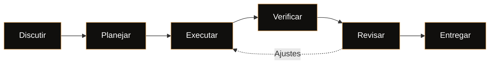
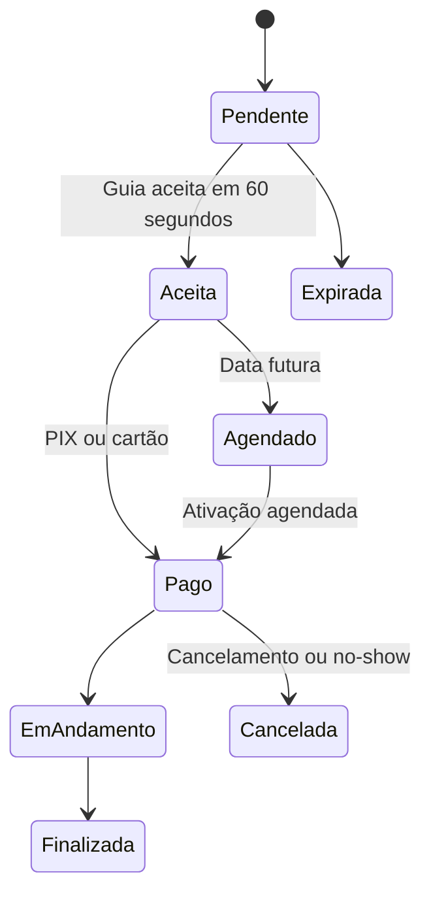

 

# Christopher Oliveira

### Full Stack Developer · Backend Engineering

**PHP · Laravel · PostgreSQL · APIs REST**

Desenvolvimento e evolução de sistemas corporativos em produção, integrações complexas e produtos digitais do zero ao deploy.

Ilhabela, São Paulo, Brasil

---

## Perfil

<table>
<tr>
<td align="center" width="25%">

### 6+

Anos de experiência

</td>
<td align="center" width="25%">

### 570+

Testes automatizados

</td>
<td align="center" width="25%">

### 5

Produtos publicados

</td>
<td align="center" width="25%">

### PHP 8.2–8.4

CI automatizado

</td>
</tr>
</table>

## Sobre mim

Desenvolvedor Full Stack na **iiBrasil Inteligência e Informação** desde 2020. Minha trajetória começou no suporte técnico e evoluiu para o desenvolvimento de software, com atuação na manutenção e modernização de sistemas corporativos de gestão pública em produção.

Minha especialidade é **backend com PHP e Laravel**. Trabalho com regras de negócio complexas, APIs REST, modelagem relacional, otimização de consultas SQL, controle de acesso, processamento assíncrono e integrações entre sistemas. Tenho experiência na evolução de bases de código legadas, priorizando integridade dos dados, segurança, desempenho e compatibilidade com operações existentes.

Paralelamente, desenvolvo produtos digitais para clientes reais e projetos próprios, participando de todo o ciclo de desenvolvimento: arquitetura, banco de dados, frontend, infraestrutura, testes automatizados e deploy.

Acredito em engenharia de software orientada a resultados: entender o problema antes de implementar, validar as decisões técnicas e entregar soluções sustentáveis para o ambiente real de produção.

**Formação:** Análise e Desenvolvimento de Sistemas · Pós-graduação em Gerenciamento de Projetos.

## Stack tecnológica

| Área | Tecnologias e práticas |
|---|---|
| **Backend** | PHP, Laravel, Eloquent ORM, APIs REST, filas, eventos, broadcasting e ACL |
| **Frontend** | JavaScript, TypeScript, React, Next.js, Tailwind CSS e Vite |
| **Banco de dados** | PostgreSQL, MySQL, Supabase, modelagem relacional e otimização de queries |
| **Infraestrutura** | Docker, Nginx, Linux, AWS S3, Azure Blob Storage e Vercel |
| **Integrações** | Mercado Pago, PIX, webhooks assinados, Pusher, Laravel Echo e Leaflet |
| **Qualidade** | PHPUnit, testes E2E, GitHub Actions, Sentry e revisão de código |

## Engenharia de software com IA

Utilizo **Claude Code** como ferramenta de engenharia dentro de um fluxo estruturado, apoiado por skills específicas para planejamento, implementação, testes, revisão e investigação de problemas.

A IA acelera a execução, mas as decisões de arquitetura, a validação das mudanças e a responsabilidade técnica continuam sob minha supervisão.

| Etapa | Processo | Objetivo |
|---|---|---|
| 01 | Discussão e especificação | Resolver ambiguidades e registrar decisões |
| 02 | Planejamento | Definir dependências e critérios de aceite |
| 03 | Implementação | Executar tarefas em etapas pequenas e rastreáveis |
| 04 | Verificação | Validar comportamento e automatizar testes |
| 05 | Revisão | Identificar bugs, riscos de segurança e problemas de interface |
| 06 | Investigação | Mapear código existente e corrigir problemas com evidências |

No **Guivya**, esse fluxo foi aplicado em auditorias de código, correções organizadas em PRs, migração do gateway de pagamento e implementação de uma política de CSP sem `unsafe-inline`, com testes e CI como parte do processo de validação.

## Projetos em destaque

### Guivya — Marketplace de passeios

**Laravel 12 · PostgreSQL · Pusher · Mercado Pago · Leaflet · Docker**

Marketplace de turismo que conecta visitantes a guias locais de Ilhabela, com reservas em tempo real, pagamentos e acompanhamento da localização no mapa.

**Principais entregas técnicas**

- Máquina de estados com transições controladas e expiração automática de solicitações.
- Integração com Mercado Pago para PIX e cartão, com validação de webhooks e fluxo de reembolso.
- Comunicação em tempo real por WebSockets e atualização do mapa com localização de guias e pontos turísticos.
- Agendamento de passeios, ativação programada, lembretes e geofence de chegada.
- Mais de 570 testes automatizados, CI para PHP 8.2, 8.3 e 8.4, CSP sem `unsafe-inline` e monitoramento com Sentry.

Projeto em desenvolvimento · Repositório privado

### Outros produtos publicados

<table>
<tr>
<td width="50%" valign="top">

**[Rotamar Ilhabela](https://www.rotamarilhabela.com.br/)**

Experiência digital para passeios de lancha e observação de baleias-jubarte, com visualizador 3D interativo da embarcação.

`Three.js` `GLTF/Draco` `JSON-LD`

</td>
<td width="50%" valign="top">

**[Importados da Ilha](https://www.importadosdailha.com.br/)**

E-commerce de eletrônicos com catálogo de produtos, painel administrativo, preços para PIX e parcelamento.

`Next.js` `TypeScript` `Supabase`

</td>
</tr>
<tr>
<td width="50%" valign="top">

**[Pato Guia Ilhabela](https://www.patopasseioilhabela.com/)**

Site mobile-first para guia local, com foco em experiência de navegação e desempenho.

`HTML` `CSS` `JavaScript`

</td>
<td width="50%" valign="top">

**[TOTI](https://www.eutoti.com.br/)**

Site oficial de artista com integração a plataformas de streaming e vídeo.

`HTML` `CSS` `JavaScript`

</td>
</tr>
<tr>
<td width="50%" valign="top">

**[Ilha dos Tesouros](https://ilha-tesouro.vercel.app/)**

Jogo web multiplayer 3D com física, sistema de ranking e loja integrada.

`React Three Fiber` `Rapier` `Supabase`

</td>
<td width="50%" valign="top">

**[Detector de Cores](https://github.com/vanngilha/color-detector)**

Ferramenta de identificação de cores em tempo real por webcam, utilizando visão computacional.

`Python` `OpenCV`

</td>
</tr>
</table>

Parte dos sistemas corporativos e dos projetos de clientes está em repositórios privados. Posso apresentar decisões de arquitetura e detalhes técnicos em uma conversa profissional.

## Certificações

- [CS50x — Harvard University](https://certificates.cs50.io/81532b44-9b96-4a68-bf98-cd162cff7011.pdf?size=letter)
- [AWS Educate — Introdução à Nuvem 101](https://www.credly.com/badges/c719bd98-a004-432f-9f88-b9613179c0a8/public_url)
- [AWS Educate — Segurança na Nuvem](https://www.credly.com/badges/b033e451-6ff9-42ac-ae50-4d585974dcfa/public_url)

## Contato

Aberto a oportunidades **Backend e Full Stack**, posições CLT ou PJ, projetos freelance e colaborações técnicas.

