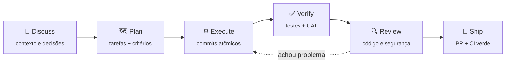
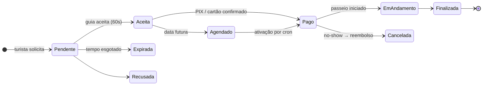

<div align="center">

<a href="https://www.chrisoliveira.dev">
  
</a>

<a href="https://www.chrisoliveira.dev">
  
</a>

<p>
  <a href="https://www.chrisoliveira.dev"></a>
  <a href="https://www.linkedin.com/in/chriisoliveira"></a>
  <a href="mailto:ceo@chrisoliveira.dev"></a>
  <a href="https://api.whatsapp.com/send?phone=5512991065780"></a>
</p>

<p>
  
  
  
  
</p>

</div>

<br>

<table align="center">
  <tr>
    <td align="center" width="170"><h2>6+ anos</h2><sub>em produção<br>desde 2020</sub></td>
    <td align="center" width="170"><h2>570+</h2><sub>testes automatizados<br>no Guivya</sub></td>
    <td align="center" width="170"><h2>6</h2><sub>produtos no ar<br>com domínio próprio</sub></td>
    <td align="center" width="170"><h2>3×</h2><sub>versões de PHP<br>no CI (8.2 · 8.3 · 8.4)</sub></td>
  </tr>
</table>

---

## 👨‍💻 Sobre mim

**Desenvolvedor Full Stack** na **iiBrasil Inteligência e Informação** desde 2020. Entrei em suporte técnico, migrei para desenvolvimento e hoje entrego em toda a stack.

No trabalho mantenho e evoluo **sistemas corporativos de gestão em produção**, com base legada em **PHP e MySQL**. Trabalhar com legado me ensinou o que curso nenhum ensina: ler código dos outros, mudar o que é crítico sem quebrar o que funciona e resolver problema de verdade, com restrição de verdade.

Minha maior força é **backend com PHP e Laravel**: APIs REST, modelagem com Eloquent, otimização de queries, autenticação/ACL, filas, eventos, relatórios e integração com serviços de terceiros. Em paralelo, construo **produtos completos do zero**: e-commerce com painel admin, sites para clientes reais e um marketplace de turismo com pagamentos e tempo real.

```yaml
cargo_atual:  Desenvolvedor Full Stack @ iiBrasil (desde 2020)
atuando_com:  Sistemas legados, APIs, novas features e manutenção crítica
paralelo:     Produtos próprios e para clientes, do zero ao deploy
foco:         Backend PHP/Laravel · arquitetura · banco de dados
ia:           Claude Code com skills de planejamento, review e segurança
metodologia:  Kanban (atual) · Scrum (anterior)
formacao:     ADS + MBA em Gestão de Projetos (Faveni)
aberto_a:     Vagas backend/full stack, freelas e colaborações
```

---

## 🤖 Como eu desenvolvo com IA

<p>
  
  
</p>

Uso o **Claude Code** no dia a dia, mas não como gerador de código solto, e sim dentro de um **fluxo com etapas, critérios e verificação**. Configurei um conjunto de **skills** que transformam cada feature num ciclo previsível: discutir → planejar → executar → verificar → revisar → entregar. A IA acelera; **a decisão de arquitetura, a revisão e a responsabilidade pelo código são minhas**.



<details open>
<summary><b>Skills que uso de verdade</b></summary>

<br>

| Skill | Para que serve no meu fluxo |
|---|---|
| 🧭 **Discuss / Spec phase** | Levanta as ambiguidades antes de escrever código e registra as decisões da feature |
| 🗺️ **Plan phase** | Quebra a entrega em tarefas com dependências e critérios de aceite verificáveis |
| ⚙️ **Execute phase** | Implementa plano a plano, com commits atômicos e rastreáveis |
| ✅ **Verify work / Add tests** | Confere se o objetivo foi atingido de ponta a ponta e gera testes a partir dos critérios |
| 🔍 **Code review** | Revisão de diffs e PRs focada em bugs reais, não em estilo |
| 🛡️ **Security review** | Auditoria de segurança das mudanças antes de ir pra `main` (CSP, auth, pagamentos) |
| 🐞 **Debug** | Investigação sistemática de bugs, com hipótese, evidência e estado persistente |
| 🎨 **UI review** | Auditoria visual do front-end implementado contra o design acordado |
| 🗂️ **Map codebase** | Mapeia stack, arquitetura e pontos de atenção de um código que eu ainda não conheço |

</details>

> **Resultado prático:** no Guivya esse fluxo conduziu auditorias completas (dezenas de bugs confirmados e corrigidos em lotes de PR), a migração de gateway de pagamento e a política de CSP sem `unsafe-inline`, sempre com testes e CI verdes antes do merge.

---

## 🛠️ Stack

<p align="center">
  
  <br><br>
  
</p>

<p align="center">
  
  
  
  
  
  
</p>

<details>
<summary><b>Detalhes da stack: o que uso de verdade no dia a dia</b></summary>

<br>

| Área | Ferramentas |
|---|---|
| **Back-end** | PHP, Laravel (Eloquent, Migrations, Middleware, ACL, Filas, Eventos, Broadcasting), APIs REST |
| **Front-end** | JavaScript, TypeScript, React, Next.js, Tailwind CSS, Vite · jQuery e Bootstrap (legado) |
| **Banco de dados** | MySQL, PostgreSQL, Supabase · modelagem relacional e otimização de queries |
| **Cloud & Infra** | Docker, Nginx, Azure (Blob Storage), AWS S3, Vercel, Render, Linux |
| **Integrações** | Mercado Pago (PIX e cartão, webhook assinado), WhatsApp, Pusher / Laravel Echo, Leaflet |
| **Testes & CI** | PHPUnit, testes E2E, GitHub Actions, Sentry |
| **IA no desenvolvimento** | Claude Code com skills de discuss/plan/execute/verify, code review, security review e debug |
| **Metodologia** | Kanban (atual) · Scrum (anterior) · code review |

</details>

---

## 🚀 Projetos

### 🏝️ Guivya · marketplace de passeios &nbsp;`em desenvolvimento` &nbsp;·&nbsp; o case de backend

`PHP 8.2` · `Laravel 12` · `PostgreSQL` · `Pusher / Laravel Echo` · `Leaflet` · `Mercado Pago` · `Docker` · `Vite` · `Tailwind CSS`

Marketplace que conecta turistas a guias locais de Ilhabela, com reserva em tempo real no modelo dos apps de mobilidade.

**O problema:** uma reserva envolve dois lados ao vivo. O turista pede, o guia tem 60 segundos para aceitar, o pagamento precisa ser confirmado e os dois se encontram num ponto da ilha. Nada disso funciona com site estático: exige estado em tempo real, transições consistentes e dinheiro tratado com cuidado.



- Domínio de reservas com **máquina de estados validada** (enum com transições permitidas) e expiração automática
- Pagamentos **PIX e cartão** via Mercado Pago, com webhook assinado, confirmação e **reembolso automático de no-show**
- Notificações em **WebSockets** e mapa ao vivo com localização de guias e pontos turísticos
- Passeios agendados: ativação por cron, lembretes T-24h/T-2h e geofence de chegada
- **570+ testes automatizados**, CI em três versões de PHP, CSP sem `unsafe-inline` e monitoramento com Sentry

> 🔒 Repositório privado. Posso apresentar o código e a arquitetura numa conversa.

<br>

<table>
  <tr>
    <td width="50%" valign="top">

### 🚢 [Rotamar Ilhabela](https://www.rotamarilhabela.com.br/)
`em produção` · cliente real

`HTML` · `CSS` · `JavaScript` · `Three.js` · `Vercel`

Operadora de passeios de lancha e avistamento de baleias jubarte, desenhada para converter visita em reserva.

- **Visualizador 3D da embarcação** (GLTF + Draco)
- Estático por decisão: rápido e sem build
- SEO com JSON-LD, sitemap e Open Graph

</td>
    <td width="50%" valign="top">

### 🛒 [Importados da Ilha](https://www.importadosdailha.com.br/)
`em produção` · cliente real

`Next.js` · `TypeScript` · `Supabase` · `PostgreSQL`

Loja de iPhone e eletrônicos com vitrine pública e **painel administrativo completo**.

- Admin com auth: estoque, ordem, oferta do dia, preços
- Preço no **PIX** e **parcelamento** por produto
- Supabase: PostgreSQL, auth e storage de imagens

</td>
  </tr>
  <tr>
    <td width="50%" valign="top">

### 🦆 [Pato Guia Ilhabela](https://www.patopasseioilhabela.com/)
`em produção` · cliente real

`HTML5` · `CSS3` · `JavaScript` · `Vercel`

Plataforma de um guia nativo: passeios, galeria, vídeos, depoimentos e FAQ.

- CSS puro mobile-first, **zero dependências**
- JSON-LD `TravelAgency` e `FAQPage`
- Avaliações reais do Google integradas

</td>
    <td width="50%" valign="top">

### 🎤 [Site oficial do TOTI](https://www.eutoti.com.br)
`em produção` · cliente real

`HTML` · `CSS` · `JavaScript` · `Vercel`

Site do artista de trap TOTI, com identidade visual forte.

- Discografia integrada ao **Spotify**
- Vitrine de vídeos do **YouTube**
- Agendamento de shows via WhatsApp

</td>
  </tr>
  <tr>
    <td width="50%" valign="top">

### 🏴‍☠️ [Ilha dos Tesouros](https://ilha-tesouro.vercel.app/)
`em produção` · projeto próprio

`Next.js` · `React Three Fiber` · `Rapier` · `Supabase`

Jogo web 3D multiplayer de exploração e pesca, com física, ranking e loja.

- Física em tempo real com Rapier
- Multiplayer e ranking em Supabase
- Loja de itens com Mercado Pago

</td>
    <td width="50%" valign="top">

### 🎨 [Detector de Cores](https://github.com/vanngilha/color-detector)
`projeto de estudo`

`Python` · `OpenCV`

Aplicação desktop que identifica cores pela webcam ao vivo usando visão computacional, exibindo nome e valores RGB na tela.

</td>
  </tr>
</table>

> A maior parte do meu trabalho (sistemas corporativos e projetos de clientes) está em repositórios privados. Os sites acima estão no ar e são o melhor retrato do que eu construo.

---

## 🎓 Formação & Certificações

<p>
  <a href="https://certificates.cs50.io/81532b44-9b96-4a68-bf98-cd162cff7011.pdf?size=letter"></a>
  <a href="https://www.credly.com/badges/c719bd98-a004-432f-9f88-b9613179c0a8/public_url"></a>
  <a href="https://www.credly.com/badges/b033e451-6ff9-42ac-ae50-4d585974dcfa/public_url"></a>
</p>

- 🎓 **Análise e Desenvolvimento de Sistemas**
- 📊 **MBA em Gerenciamento de Projetos** · Faveni
- 📚 Atualmente me aprofundando em **arquitetura de software** e nos padrões que fazem um sistema aguentar crescimento

---

## 📫 Vamos conversar?

Estou aberto a **vagas backend/full stack**, **freelas** e **colaborações técnicas**.

<p align="center">
  <a href="https://www.chrisoliveira.dev"></a>
  <a href="https://www.linkedin.com/in/chriisoliveira"></a>
  <a href="mailto:ceo@chrisoliveira.dev"></a>
  <a href="https://www.instagram.com/vanngilha/"></a>
  <a href="https://api.whatsapp.com/send?phone=5512991065780"></a>
</p>

<div align="center">


</div>
