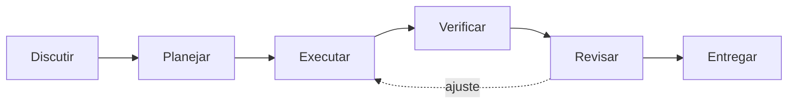
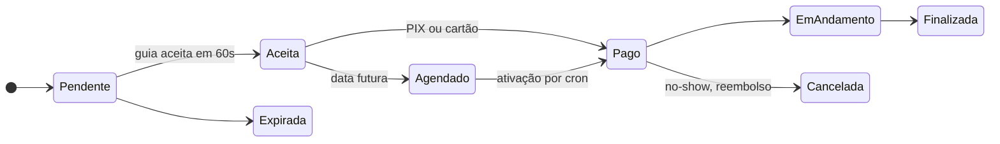

# Christopher Oliveira

**Desenvolvedor Full Stack com foco em Backend · PHP & Laravel**

Sistemas corporativos em produção desde 2020 e produtos completos do zero ao deploy.

 

<table align="center">
  <tr>
    <td align="center" width="170"><h3>6+ anos</h3>em produção, desde 2020</td>
    <td align="center" width="170"><h3>570+</h3>testes automatizados no Guivya</td>
    <td align="center" width="170"><h3>5</h3>produtos no ar, 4 para clientes reais</td>
    <td align="center" width="170"><h3>PHP 8.2 · 8.3 · 8.4</h3>matriz de CI</td>
  </tr>
</table>

## Sobre

Desenvolvedor Full Stack na **iiBrasil Inteligência e Informação** desde 2020. Entrei em suporte técnico, migrei para desenvolvimento e hoje entrego em toda a stack, mantendo e evoluindo sistemas corporativos de gestão em produção com base legada em PHP e MySQL.

Trabalhar com legado me ensinou o que curso nenhum ensina: ler código dos outros, mudar o que é crítico sem quebrar o que funciona e resolver problema de verdade, com restrição de verdade. Meu forte é **backend com PHP e Laravel**: APIs REST, modelagem com Eloquent, otimização de queries, autenticação/ACL, filas, eventos e integrações com serviços de terceiros.

Em paralelo, construo produtos completos para clientes reais e projetos próprios, todos com domínio e deploy em produção. Formado em Análise e Desenvolvimento de Sistemas, com MBA em Gerenciamento de Projetos.

## Como eu desenvolvo com IA

Uso o **Claude Code** no dia a dia dentro de um fluxo com etapas e verificação, guiado por um conjunto de **skills** configuradas para cada fase. A IA acelera; a arquitetura, a revisão e a responsabilidade pelo código são minhas.

| Fase | Skills | O que garante |
|---|---|---|
| Discutir | discuss, spec | Ambiguidades resolvidas e decisões registradas antes do código |
| Planejar | plan | Tarefas com dependências e critérios de aceite verificáveis |
| Executar | execute | Commits pequenos e rastreáveis, plano a plano |
| Verificar | verify, add-tests | Objetivo conferido de ponta a ponta, critérios viram testes |
| Revisar | code-review, security-review, ui-review | Bugs reais e falhas de segurança pegos no diff |
| Investigar | debug, map-codebase | Bug tratado com hipótese e evidência; código novo mapeado antes de mexer |

No Guivya esse fluxo conduziu auditorias completas com correções em lotes de PR, a migração do gateway de pagamento e uma política de CSP sem `unsafe-inline`, sempre com testes e CI verdes antes do merge.

## Stack

  

| | |
|---|---|
| **Backend** | PHP, Laravel (Eloquent, filas, eventos, broadcasting, ACL), APIs REST |
| **Frontend** | JavaScript, TypeScript, React, Next.js, Tailwind CSS, Vite |
| **Dados** | PostgreSQL, MySQL, Supabase, modelagem relacional e otimização de queries |
| **Infra** | Docker, Nginx, Azure Blob Storage, AWS S3, Vercel, Linux |
| **Integrações** | Mercado Pago (PIX e cartão, webhook assinado), Pusher / Laravel Echo, Leaflet, WhatsApp |
| **Qualidade** | PHPUnit, testes E2E, GitHub Actions, Sentry, Claude Code |

## Projetos

### Guivya · marketplace de passeios

`Laravel 12` `PostgreSQL` `Pusher` `Mercado Pago` `Leaflet` `Docker` · em desenvolvimento, repositório privado

Conecta turistas a guias locais de Ilhabela, com reserva em tempo real no modelo dos apps de mobilidade. O turista pede, o guia tem 60 segundos para aceitar, o pagamento é confirmado e os dois se encontram num ponto da ilha. Por trás disso:

- Máquina de estados validada em enum, com transições permitidas e expiração automática
- Pagamentos PIX e cartão via Mercado Pago, webhook assinado e reembolso automático de no-show
- Notificações em WebSockets e mapa ao vivo com a localização de guias e pontos turísticos
- Passeios agendados com ativação por cron, lembretes T-24h/T-2h e geofence de chegada
- 570+ testes, CI em três versões de PHP, CSP sem `unsafe-inline` e Sentry em produção

### Em produção

| Projeto | O que é | Stack |
|---|---|---|
| [Rotamar Ilhabela](https://www.rotamarilhabela.com.br/) | Passeios de lancha e baleias jubarte, com visualizador 3D da embarcação | Three.js, GLTF/Draco, JSON-LD |
| [Importados da Ilha](https://www.importadosdailha.com.br/) | Loja de eletrônicos com painel admin completo, preço no PIX e parcelamento | Next.js, TypeScript, Supabase |
| [Pato Guia Ilhabela](https://www.patopasseioilhabela.com/) | Site de guia nativo, mobile-first e sem dependências | HTML, CSS, JavaScript |
| [TOTI](https://www.eutoti.com.br) | Site oficial de artista, com Spotify e YouTube integrados | HTML, CSS, JavaScript |
| [Ilha dos Tesouros](https://ilha-tesouro.vercel.app/) | Jogo web 3D multiplayer com física, ranking e loja | React Three Fiber, Rapier, Supabase |
| [Detector de Cores](https://github.com/vanngilha/color-detector) | Identificação de cores pela webcam com visão computacional | Python, OpenCV |

A maior parte do meu trabalho, entre sistemas corporativos e projetos de clientes, está em repositórios privados. Posso apresentar código e arquitetura numa conversa.

## Certificações

[CS50x, Harvard](https://certificates.cs50.io/81532b44-9b96-4a68-bf98-cd162cff7011.pdf?size=letter) · [AWS Educate: Introdução à Nuvem 101](https://www.credly.com/badges/c719bd98-a004-432f-9f88-b9613179c0a8/public_url) · [AWS Educate: Segurança na Nuvem](https://www.credly.com/badges/b033e451-6ff9-42ac-ae50-4d585974dcfa/public_url)

## Contato

Aberto a vagas backend e full stack (CLT ou PJ), freelas e colaborações. O jeito mais rápido é pelo [portfólio](https://www.chrisoliveira.dev), [LinkedIn](https://www.linkedin.com/in/chriisoliveira) ou [e-mail](mailto:ceo@chrisoliveira.dev).
